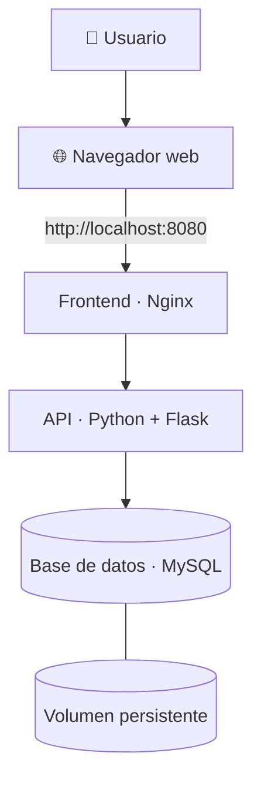

# 🚀 Gestor de Tareas — Full Stack con Docker

<p align="center">
  <strong>Aplicación web contenerizada para la gestión de tareas</strong><br>
  Frontend · API REST · Base de datos MySQL · Docker Compose
</p>

<p align="center">
  
  
  
  
  
</p>

---

## 📌 1. Descripción del proyecto

**Gestor de Tareas** es una aplicación web de arquitectura *full stack* desarrollada para demostrar cómo desplegar y conectar varios componentes de una aplicación mediante contenedores Docker.

El sistema separa la interfaz web, la lógica de negocio y el almacenamiento de datos en servicios independientes. Docker Compose permite configurar y administrar estos servicios desde un solo archivo.

El proyecto permite trabajar con tareas desde la interfaz web y utiliza una API desarrollada con Python y Flask para comunicarse con la base de datos MySQL.

### 🎯 Objetivos

- Implementar una aplicación compuesta por varios servicios contenerizados.
- Construir imágenes Docker para los componentes de la aplicación.
- Conectar el frontend, la API y MySQL dentro de una red de servicios.
- Administrar el despliegue mediante Docker Compose.
- Utilizar volúmenes para conservar los datos de la base de datos.
- Comprobar el estado de los contenedores, consultar sus registros y verificar la persistencia de la información.

## 👥 2. Integrantes

| Integrante | Participación |
|---|---|
| Eleanyeris Hernandez | Desarrollo del proyecto |
| Giseella Sanchez | Implementación y documentación |
| Angelina Ochoa | Desarrollo y pruebas |

## 🧰 3. Tecnologías utilizadas

| Tecnología | Función dentro del proyecto |
|---|---|
| **Docker** | Construcción y ejecución de contenedores. |
| **Docker Compose** | Configuración y administración conjunta de los servicios. |
| **Nginx** | Servidor web del frontend y configuración del acceso a la API. |
| **Python 3.12** | Lenguaje utilizado para desarrollar el backend. |
| **Flask** | Framework utilizado para implementar la API. |
| **MySQL 8.4** | Sistema de gestión de la base de datos relacional. |
| **PyMySQL** | Conexión de Python con MySQL. |
| **Git y GitHub** | Control de versiones y alojamiento del código fuente. |

## 🏗️ 4. Arquitectura del sistema

La aplicación está dividida en tres servicios principales:



### ¿Cómo funciona?

1. El usuario accede a la aplicación desde el navegador.
2. Nginx sirve la interfaz web y gestiona la comunicación configurada con la API.
3. La API procesa las operaciones de gestión de tareas.
4. MySQL almacena la información.
5. El volumen de Docker conserva los datos de la base de datos aunque se elimine y vuelva a crear el contenedor, siempre que el volumen se conserve.

### 📦 Servicios de Docker Compose

| Servicio | Tecnología | Responsabilidad | Acceso |
|---|---|---|---|
| `frontend` | Nginx | Servir la interfaz web. | Puerto `8080` del equipo |
| `api` | Python 3.12 + Flask | Procesar las operaciones de la aplicación. | Comunicación interna entre servicios |
| `bd` | MySQL 8.4 | Almacenar los datos de las tareas. | Comunicación interna entre servicios |

**Nota:** la API y MySQL se comunican dentro de la infraestructura de Docker. No es necesario publicar sus puertos en el equipo anfitrión para utilizar la interfaz web.

## ⚙️ 5. Requisitos previos

Antes de iniciar el proyecto, verifica que tienes:

- [Docker Desktop](https://www.docker.com/products/docker-desktop/) instalado y abierto.
- Docker Engine en ejecución.
- [Git](https://git-scm.com/downloads) instalado.
- Conexión a Internet durante la descarga inicial de imágenes y dependencias.
- Los puertos necesarios disponibles, especialmente el `8080`.

No necesitas instalar Python, Flask, MySQL ni Nginx directamente en Windows para ejecutar los servicios contenerizados.

### Comprobar las instalaciones

Abre PowerShell o una terminal y ejecuta:

```powershell
git --version
docker --version
docker compose version
docker info
```

Los tres primeros comandos deben mostrar sus versiones. `docker info` debe mostrar información del motor Docker sin errores de conexión.

## 🚀 6. Instalación y ejecución

### Paso 1. Clonar el repositorio

```powershell
git clone https://github.com/gpsanchezr/fullstack-docker-task-manager.git
```

### Paso 2. Entrar en la carpeta del proyecto

```powershell
cd fullstack-docker-task-manager
```

Comprueba que estás en la carpeta que contiene `compose.yaml`, `README.md`, `api/` y `frontend/`.

### Paso 3. Configurar las variables de entorno

Crea tu archivo local `.env` a partir de la plantilla:

```powershell
Copy-Item .env.example .env
```

Abre `.env` y revisa las variables de configuración, especialmente las credenciales y los datos de conexión con MySQL.

**Importante:** si ya existe un archivo `.env`, no lo sobrescribas sin revisar su contenido. No publiques ese archivo ni compartas contraseñas reales en GitHub.

### Paso 4. Validar la configuración

```powershell
docker compose config
```

Este comando permite detectar problemas de sintaxis o configuración antes de iniciar los servicios. Si muestra un error, corrige la configuración indicada.

### Paso 5. Construir y levantar la aplicación

```powershell
docker compose up -d --build
```

Docker construirá las imágenes que correspondan e iniciará los servicios en segundo plano.

### Paso 6. Verificar el estado de los contenedores

```powershell
docker compose ps
```

Comprueba que `frontend`, `api` y `bd` hayan arrancado correctamente. Si algún servicio se detiene o aparece con errores, consulta sus registros antes de continuar.

### Paso 7. Abrir la aplicación

Accede desde tu navegador a:

**http://localhost:8080**

La interfaz web debería aparecer una vez que los servicios hayan iniciado correctamente.

## 🧪 7. Verificación y pruebas

Las siguientes comprobaciones permiten diagnosticar el funcionamiento del despliegue.

### Consultar los servicios en ejecución

```powershell
docker compose ps
```

### Ver los registros de todos los servicios

```powershell
docker compose logs
```

### Consultar los registros en tiempo real

```powershell
docker compose logs -f
```

Para salir de la visualización de registros, pulsa `Ctrl + C`. Esto detiene la consulta de los registros, no necesariamente los contenedores.

### Revisar un servicio específico

```powershell
docker compose logs api
docker compose logs bd
docker compose logs frontend
```

### Comprobar el acceso HTTP

En PowerShell:

```powershell
Invoke-WebRequest http://localhost:8080
```

Verifica que la respuesta HTTP sea correcta. Después, comprueba directamente en la interfaz las operaciones disponibles: crear una tarea, consultar las tareas, modificar su estado y eliminarla.

### Lista de comprobación

- [ ] Los tres servicios aparecen en ejecución.
- [ ] La página web abre en `http://localhost:8080`.
- [ ] La interfaz se comunica correctamente con la API.
- [ ] La aplicación permite crear y consultar tareas.
- [ ] Las operaciones de modificación y eliminación funcionan.
- [ ] La conexión entre la API y MySQL funciona correctamente.
- [ ] Los registros no muestran errores que impidan utilizar la aplicación.

Marca cada comprobación únicamente después de realizarla.

## 💾 8. Persistencia de los datos

El proyecto utiliza un volumen de Docker para conservar los datos de MySQL.

El volumen definido en `compose.yaml` es:

```yaml
datos-bd:
```

Su montaje se realiza en la ubicación de datos de MySQL dentro del contenedor.

Esto permite que los datos sobrevivan a la eliminación y recreación del contenedor de base de datos, siempre que no se elimine el volumen.

### Prueba de persistencia

Primero, crea una tarea desde la aplicación y confirma que aparece en la interfaz.

Después, ejecuta:

```powershell
docker compose down
docker compose up -d
docker compose ps
```

Cuando todos los servicios estén listos, abre de nuevo `http://localhost:8080` y verifica que la tarea continúe existiendo.

**Advertencia:** no utilices `docker compose down -v` en esta prueba. La opción `-v` elimina los volúmenes asociados al proyecto y podría borrar los datos persistidos.

## 🗂️ 9. Estructura del proyecto

La estructura principal del repositorio es la siguiente:

```text
fullstack-docker-task-manager/
│
├── api/
│   ├── app.py
│   ├── Dockerfile
│   ├── requirements.txt
│   └── .dockerignore
│
├── frontend/
│   ├── Dockerfile
│   ├── index.html
│   └── nginx.conf
│
├── evidencias/
│
├── .env.example
├── .gitignore
├── compose.yaml
└── README.md
```

### Descripción de los archivos principales

| Archivo o carpeta | Descripción |
|---|---|
| `api/app.py` | Código de la aplicación backend y sus rutas. |
| `api/Dockerfile` | Instrucciones para construir la imagen de la API. |
| `api/requirements.txt` | Dependencias de Python. |
| `frontend/index.html` | Interfaz web de la aplicación. |
| `frontend/Dockerfile` | Instrucciones para construir la imagen del frontend. |
| `frontend/nginx.conf` | Configuración de Nginx. |
| `compose.yaml` | Definición y configuración conjunta de los servicios. |
| `.env.example` | Plantilla de variables de entorno necesarias. |
| `.gitignore` | Archivos y carpetas que Git debe ignorar. |
| `evidencias/` | Capturas reales de las pruebas de funcionamiento y persistencia. |

Si la estructura local incorpora otros archivos o subcarpetas, actualiza este árbol para que corresponda exactamente con lo publicado.

## 🛠️ 10. Comandos útiles

| Acción | Comando |
|---|---|
| Construir e iniciar | `docker compose up -d --build` |
| Iniciar sin reconstruir | `docker compose up -d` |
| Ver estado | `docker compose ps` |
| Ver registros | `docker compose logs` |
| Seguir registros | `docker compose logs -f` |
| Ver registros de la API | `docker compose logs api` |
| Detener y eliminar contenedores de Compose | `docker compose down` |
| Reconstruir las imágenes | `docker compose build --no-cache` |
| Revisar la configuración | `docker compose config` |

Ejecuta estos comandos desde la carpeta raíz donde se encuentra `compose.yaml`.

## 🧯 11. Solución de problemas frecuentes

### Docker no está disponible

**Posible causa:** Docker Desktop está cerrado o el motor no ha terminado de iniciarse.

**Qué hacer:** abre Docker Desktop, espera a que el motor esté disponible y vuelve a ejecutar:

```powershell
docker info
```

### El puerto 8080 está ocupado

**Síntoma:** el servicio frontend no puede publicar su puerto.

**Qué hacer:** identifica qué aplicación está utilizando el puerto o cambia el mapeo del frontend en `compose.yaml`. Si cambias el puerto del equipo anfitrión, utiliza el nuevo puerto al abrir la aplicación.

### La API no se conecta a MySQL

**Posibles causas:** credenciales incorrectas, variables de entorno desalineadas, base de datos todavía no lista o errores de inicialización.

**Qué hacer:**

```powershell
docker compose logs bd
docker compose logs api
```

Revisa `.env`, `.env.example` y la configuración de conexión de la API. Confirma que el nombre del host de base de datos corresponda al servicio de Compose y no a `localhost` dentro del contenedor de la API.

### La página web no se muestra correctamente

**Qué hacer:**

```powershell
docker compose ps
docker compose logs frontend
docker compose logs api
```

Comprueba el estado de los servicios y la configuración del proxy de Nginx en `frontend/nginx.conf`.

### Las tareas desaparecen después de reiniciar

**Qué hacer:** confirma que el volumen de MySQL está declarado y montado correctamente en `compose.yaml`. Verifica también que la aplicación está guardando los datos en esa misma base de datos y no en un almacenamiento temporal.

## 🔐 12. Buenas prácticas de seguridad

- No publiques contraseñas, tokens ni credenciales reales.
- Utiliza `.env.example` como plantilla de configuración.
- Mantén `.env` excluido del control de versiones mediante `.gitignore`.
- Evita publicar puertos internos que no sean necesarios para el uso de la aplicación.
- No elimines los volúmenes mientras estés comprobando la persistencia.
- No afirmes que una prueba fue exitosa si no has comprobado el resultado.
- Revisa los registros de Docker cuando ocurra un error de ejecución.

## 📸 13. Evidencias y sustentación del proyecto

En esta sección se presentan las evidencias visuales del desarrollo y las pruebas del **Gestor de Tareas Full Stack con Docker**. Las capturas permiten identificar los procedimientos realizados durante las fases del taller y sirven como apoyo para explicar la construcción, ejecución y validación de la aplicación.

### 🖼️ Galería de evidencias — Fases 1 a 5

<p align="center">
  
</p>

<p align="center">
  <em>Figura 1. Resumen visual de las evidencias técnicas recopiladas durante el desarrollo del taller.</em>
</p>

### 🔎 ¿Qué demuestran las capturas?

| Fase | Evidencia | Descripción |
|---|---|---|
| **Fase 1** | Ejecución de contenedores | Permite observar el estado de un contenedor mediante los comandos de Docker. |
| **Fase 2** | Construcción y registros de la API | Documenta la construcción de la imagen y los mensajes de inicio del servicio. |
| **Fase 3** | Comparación de versiones 1.0 y 1.1 | Presenta las imágenes y las respuestas de la API utilizadas para comparar ambas versiones. |
| **Fase 4** | Persistencia en MySQL | Sirve de apoyo para explicar la conservación de los registros después de recrear el contenedor de base de datos. |
| **Fase 5** | Aplicación con Docker Compose | Muestra los servicios del sistema y la interfaz del gestor de tareas, junto con la prueba de persistencia después del reinicio. |

### 🎓 Sustentación técnica

Las evidencias respaldan la explicación de los siguientes conceptos:

- **Contenerización:** creación y ejecución de servicios aislados mediante Docker.
- **Construcción de imágenes:** definición de las instrucciones necesarias para empaquetar la API.
- **Versionamiento:** comparación del comportamiento de dos versiones de la API.
- **Persistencia:** utilización de volúmenes para conservar los datos de MySQL.
- **Orquestación:** configuración y administración conjunta del frontend, la API y la base de datos mediante Docker Compose.

Las imágenes se presentan como documentación de apoyo. Los resultados deben interpretarse de acuerdo con lo que realmente muestra cada captura y complementarse con las comprobaciones realizadas en el entorno de ejecución.

**Ubicación de las evidencias:** `evidencias/`

La carpeta contiene el documento PDF del taller y los archivos gráficos utilizados para documentar las pruebas.


## 🤝 14. Reproducción por otro equipo

Para comprobar que el proyecto es reproducible, otro equipo debe:

1. Clonar el repositorio desde GitHub.
2. Revisar el README y configurar su propio `.env`.
3. Construir e iniciar los servicios.
4. Acceder a la interfaz desde el navegador.
5. Probar las operaciones de la aplicación.
6. Detener y reiniciar los contenedores para comprobar la persistencia.
7. Registrar los resultados, errores encontrados y correcciones necesarias.

Documenta el resultado real de esta prueba en `PRUEBA_CRUZADA.md` y conserva las evidencias correspondientes.

## 📋 15. Estado de validación

El hecho de que el proyecto incluya Dockerfile, Compose y documentación no significa por sí solo que todas las pruebas hayan sido superadas.

Antes de la entrega, verifica y documenta:

- [ ] Construcción de las imágenes.
- [ ] Inicio correcto de los tres servicios.
- [ ] Acceso web.
- [ ] Operaciones de gestión de tareas.
- [ ] Comunicación entre API y MySQL.
- [ ] Persistencia de los datos.
- [ ] Evidencias incluidas en el repositorio.
- [ ] Prueba cruzada documentada.
- [ ] Ausencia de credenciales privadas en los archivos publicados.

## 📚 16. Repositorio

Código fuente y documentación del proyecto:

**[GitHub — Full Stack Docker Task Manager](https://github.com/gpsanchezr/fullstack-docker-task-manager)**

---

<p align="center">
  <strong>Gestor de Tareas · Full Stack · Docker</strong><br>
  <sub>Proyecto académico de contenerización, despliegue y persistencia de aplicaciones.</sub>
</p>
